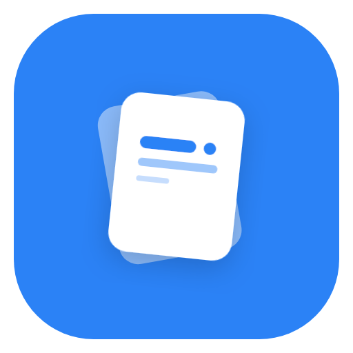
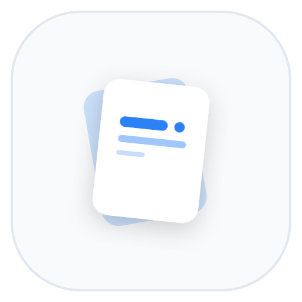
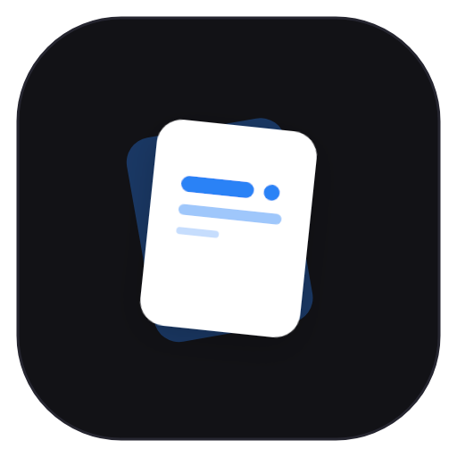
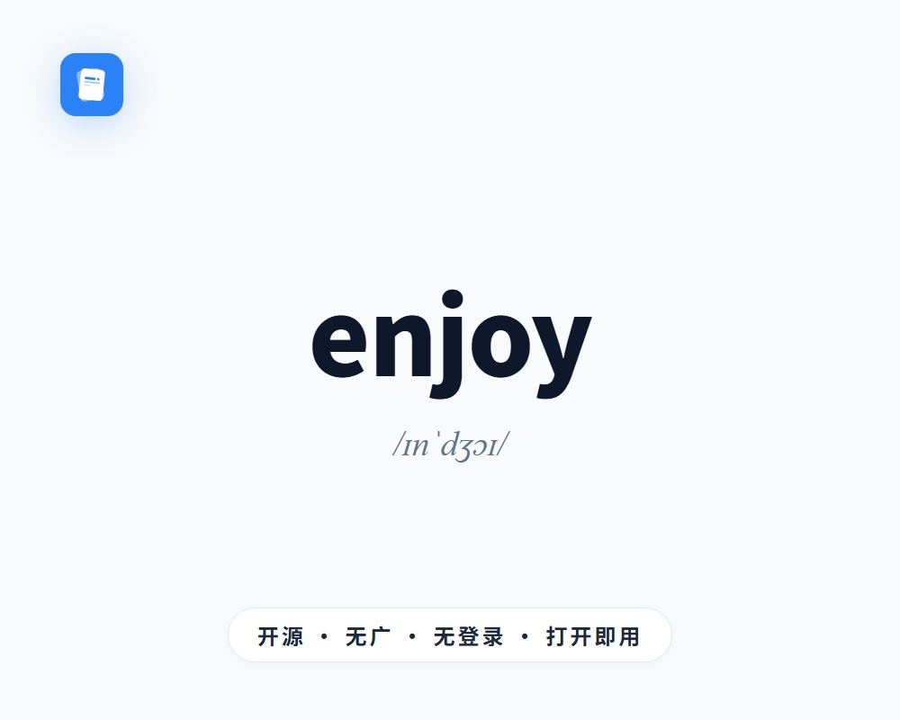

# 🎨 EnglishJoy 品牌与视觉资源规范 (Brand Assets)

本项目遵循**极简、专注、纯粹**的设计美学，所有视觉资源归档于 `docs/images/`。

---

## 1. 官方 Logo 规范（双卡叠层悬浮标 · Floating Cards）

Logo 采用两张微倾斜交错叠放的抽认卡（Flashcards）形态，前卡浮现清晰的词汇横线与音标圆点，彻底回归产品最核心的交互与心智——**沉浸、纯粹、极简的抽认卡背单词**。富有 Notion、Craft 等高质感生产力工具美学。

提供了三种官方配色版本（均提供 512×512 高清 PNG 及无损可缩放 SVG 矢量原文件）：

| 蓝底白卡 (Classic Blue) | 白底白卡+蓝横线 (Clean White) | 黑底白卡+蓝横线 (Midnight Dark) |
| :---: | :---: | :---: |
|  |  |  |
| [PNG](images/logo-blue-white.png) · [SVG](images/logo-blue-white.svg) | [PNG](images/logo-white-blue.png) · [SVG](images/logo-white-blue.svg) | [PNG](images/logo-dark-blue.png) · [SVG](images/logo-dark-blue.svg) |
| **主品牌色** / 小程序图标 | 浅色主题 / 文档与白底排版 | 深色主题 / 暗黑模式适配 |

---

## 2. 微信分享卡片 (5:4 WeChat Share Cover)

针对微信小程序分享给好友、群聊以及朋友圈场景进行黄金比例（5:4 / 1000×800）专属定制。摒弃冗余的按钮和操作说明，采用瑞士国际主义大单词排版，直击“纯粹背单词”的核心心智。

  
   
  <b>微信分享卡片效果图（存储于 <code>src/static/share-cover.jpg</code> 与 <code>docs/images/share-cover.jpg</code>）</b>

### 视觉与分享特性
- **分享文案**：`发现一个极简背单词小程序，打开即用`（标题干净整洁，不再堆砌单词）。
- **动态渲染技术**：利用离线 **Canvas 2D** 实时捕获当前正在背诵的单词与音标，动态绘制 1000×800 高清 5:4 分享图。
- **左上角微标**：双卡叠层悬浮标（方案 B）微缩 App 图标，纯净克制、层级分明。
- **视觉重心**：超大字号展示当前背诵单词 + 国际音标，去除词性标签干扰。
- **底部核心 Slogan**：精致胶囊注脚 `开源 · 无广 · 无登录 · 打开即用`。
